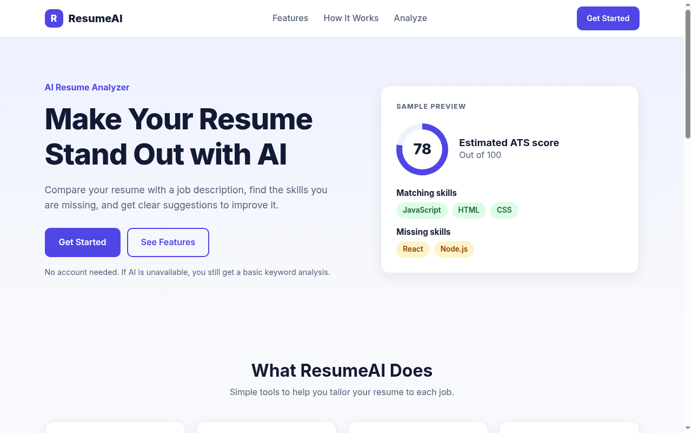
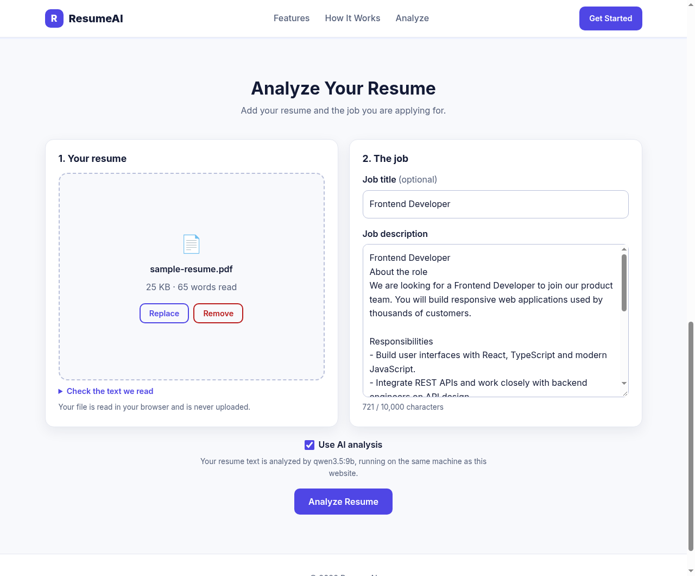
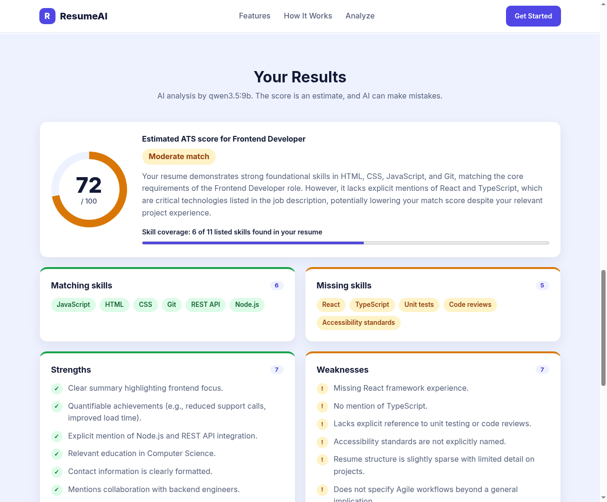
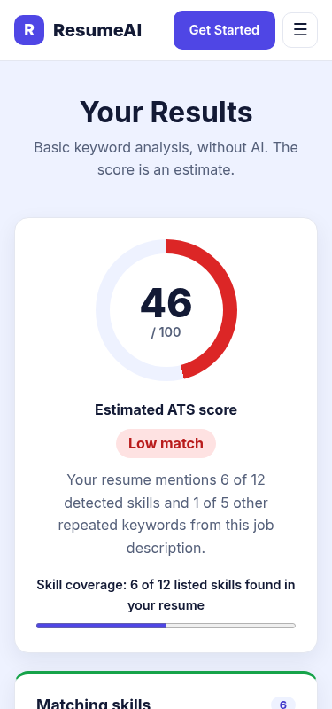

# ResumeAI

An AI resume analyzer. Upload your resume, paste a job description, and see an
estimated match score, skill gaps and practical suggestions.



## Features

- PDF and DOCX upload with drag and drop, read inside your browser
- Estimated ATS compatibility score out of 100
- Matching and missing skills, strengths, weaknesses and keyword ideas
- AI analysis through any OpenAI-compatible service, including free local Ollama
- Basic keyword analysis in the browser when AI is off or unavailable
- Downloadable text report, and printing to PDF
- Works on desktop and phone screens, with no account or database

> The score is an estimate. It does not come from any real applicant tracking
> system.

## Screenshots

| Add your resume and the job | Results |
| --- | --- |
|  |  |



The screenshots use a fictional resume.

## Setup

You need [Node.js](https://nodejs.org) 20.12 or newer (tested with Node 26) and
an internet connection for the file reading libraries.

```bash
git clone https://github.com/nimiseervi2-sudo/Resume-AI.git
cd Resume-AI
npm install
cp .env.example .env   # skip if you already have a .env file
npm start
```

Open <http://127.0.0.1:5500>. Opening `index.html` directly also works, but only
with the basic analysis.

## Set up free AI analysis

Edit `.env`, then restart the server.

### Option 1: Ollama (free, private, on your computer)

1. Install [Ollama](https://ollama.com).
2. Download the model: `ollama pull qwen3.5:9b` (about 6.6 GB).
3. Keep the Ollama settings from `.env.example`.

The first request is slow while the model loads. Long resumes need a context
length of about 16,000 tokens (`OLLAMA_CONTEXT_LENGTH=16384`); with a smaller
one, Ollama may silently cut off text.

### Option 2: A hosted service

Create an API key at [Groq](https://console.groq.com/keys) or
[Google AI Studio](https://aistudio.google.com), then use the matching block in
`.env.example`. Free tiers have usage limits that change, and may store or learn
from what you send, so check the provider's terms. The hosted options follow the
same API format but have not been tested with a real key in this project.

## Environment variables

| Variable | Meaning | Default |
| --- | --- | --- |
| `PORT` | Web server port | `5500` |
| `HOST` | `127.0.0.1` locally, `0.0.0.0` on a hosting service | `127.0.0.1` |
| `TRUST_PROXY` | Set to `1` behind a hosting service's proxy | empty |
| `LLM_BASE_URL` | Address of the AI service | empty (AI off) |
| `LLM_MODEL` | Model name | empty (AI off) |
| `LLM_API_KEY` | Secret key, not needed for local Ollama | empty |
| `LLM_REASONING_EFFORT` | Optional; `none` speeds up Ollama reasoning models | empty |
| `LLM_TIMEOUT_MS` | Longest wait for an AI reply, in milliseconds | `120000` |

Never commit `.env`. It is listed in `.gitignore`.

## Deploy on Render

A hosted website cannot reach Ollama on your computer, so you need a hosted AI
key. `render.yaml` is set up for Groq.

1. Create a Groq API key.
2. Sign in at [Render](https://render.com) and connect your GitHub account.
3. Choose **New**, then **Blueprint**, and select this repository.
4. When asked for `LLM_API_KEY`, paste your key.
5. Apply the Blueprint and wait for the deploy to finish.
6. Open the site, run an analysis and check that it says "AI analysis by ...".

To deploy without a Blueprint, create a **Web Service** with build command
`npm ci`, start command `npm start`, and the variables listed in `render.yaml`.

Good to know:

- Render's [free web services](https://render.com/docs/free) sleep after 15
  minutes without traffic and take about a minute to wake.
- Anyone who can open your site can use your AI quota. Each address is limited to
  10 requests per minute, which does not cap total use. Behind a proxy, check
  that visitors are not all counted as one address.
- Without a key the site still works, using the basic analysis.

## How the analysis works

**AI analysis.** The server sends the resume text and job details to the AI
service and asks for a fixed JSON format. Answers in the wrong format are
rejected. A skill is shown as matched only if the resume text mentions it. Other
AI text is not verified, so read it critically. Scores can differ between runs.

**Basic analysis.**

1. It looks for known skills (listed at the top of `js/analyzer.js`) in the job
   description, then checks which of them your resume mentions.
2. It also picks up to 10 other words or phrases the job description repeats.
3. Skills make up 75% of the score and other keywords 25%. Soft skills count half
   as much as technical skills. If only one group is found, it is the whole score.

The dashboard calls a score of 75 or more a strong match, 50 to 74 moderate, and
anything lower a low match.

## Privacy and safety

- The resume file never leaves your browser. With AI on, its text and the job
  details are sent to the server and on to the AI service. The page says where,
  and you can untick AI.
- The API key stays on the server. `.env` is never served.
- The server does not save or log resume content.

## Known limits

- Scanned (image only) resumes cannot be read.
- Text in DOCX page headers and footers is not extracted.
- Multi-column layouts may be read in an unexpected order.
- The basic analysis matches words, not meaning. It does not understand phrases
  such as "no PHP needed", knows only the skills in its list, and works best in
  English.
- Files up to 5 MB, job descriptions up to 10,000 characters, and AI analysis for
  resumes up to 30,000 characters.

## Tests

```bash
npm test
```

## Project structure

```
index.html          Page content
css/style.css       Styling, including phone and print layouts
js/app.js           Menu, file selection, form and analysis flow
js/resumeParser.js  Reads text from PDF and DOCX files
js/analyzer.js      Basic keyword analysis and scoring
js/dashboard.js     Shows the results
js/report.js        Builds the downloadable report
backend/server.js   Web server
backend/routes/     AI analysis API
tests/              Automated tests
render.yaml         Deployment settings for Render
memory.md           Project log: state, decisions and next steps
```

## Built with

HTML, CSS, JavaScript, Node.js, [Express](https://expressjs.com),
[PDF.js](https://mozilla.github.io/pdf.js/) 6.5.438 and
[Mammoth.js](https://github.com/mwilliamson/mammoth.js) 1.13.0.
